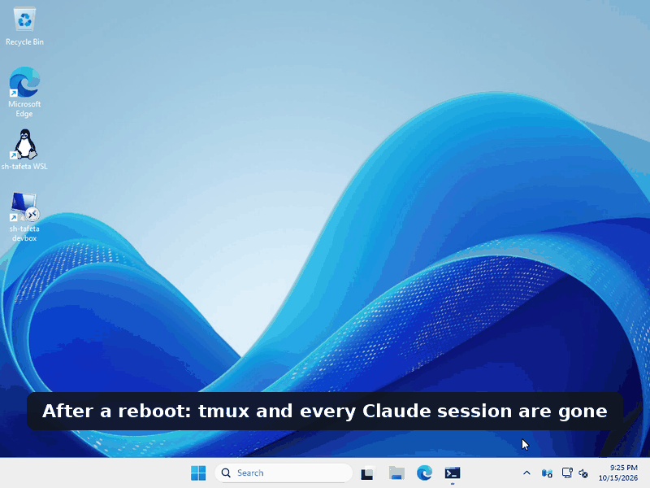
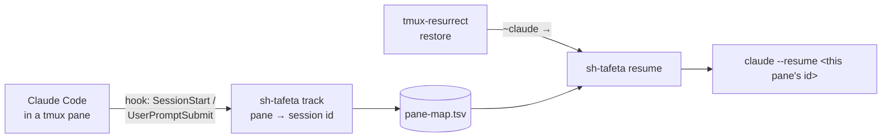

<h1 align="center">sh-tafeta 🏊‍♂️</h1>

<p align="center">
  <b>Hand your Claude Code sessions over across reboots, terminals and machines.</b><br>
  <i><b>sh</b> + <b>staffetta</b> (Italian for relay race), the way my coach Bane used to say it: "shtafeta". Nobody stops swimming: one touches the wall, the next one is already in the water.</i>
</p>

<p align="center">
  
  
  
  
</p>

<p align="center"></p>
<p align="center"><sub>Recorded on a clean Windows + WSL2 machine; Claude Code is a labelled stand-in in the recording.</sub></p>

---

You run Claude Code in tmux. Several sessions, often in the **same folder**. Then:

| What happens | What you get without sh-tafeta | With sh-tafeta |
|---|---|---|
| 💥 The PC reboots | tmux-resurrect brings back the layout, but Claude panes start **empty** — or, with `claude --continue`, **every pane in the same folder opens the same conversation** | Every pane reopens **its own** conversation (`claude --resume <id>`) |
| 🕐 WSL boots and the clock jumps forward | tmux-continuum thinks the server is old, **silently skips the restore**, and 10 minutes later overwrites your snapshot with an empty layout | `sh-tafeta restore` notices and restores anyway |
| 🪟 You live in Windows Terminal | One tab, then `tmux attach -t …` by hand, for every session, every morning | One click: **one tab per tmux session**, with readable titles — locally in WSL or on a remote box over ssh/mosh |
| 📸 Claude runs on a server, your screenshots are on Windows | Save, `scp`, type the path… for every screenshot | `Win+Shift+S`, then `Ctrl+V` in Claude: the image is already there and its path on the clipboard |
| 🛫 You move between laptop and server | Sessions and project memory stay on the machine where they were created (Claude Code keys them by absolute path) — and "newest file wins" sync tools happily overwrite real work with an old copy that has a fresh date | `sh-tafeta sync devbox` — paths mapped, decisions by content against the last sync, **never overwrites work it hasn't seen** |

## How it works



- **track** runs as an async Claude Code hook (~12 ms). It records which session runs in which pane and re-records on every prompt. A session resumed in another pane moves with you: one pane per session, one session per pane. Nested Claudes (a `claude -p` started by a tool) are ignored.
- **snapshot** runs every time tmux-resurrect saves the layout and freezes "pane position → session" next to it, so a restore puts every conversation back exactly where the restored layout puts its pane — even if you moved panes after the last prompt.
- **resume** is what tmux-resurrect runs in a pane that used to hold `claude`. No mapping? It falls back to the interactive picker — never to `--continue`.
- **restore** starts tmux, gives tmux-continuum a few seconds, and if nothing came back (the WSL clock-jump case) runs the tmux-resurrect restore itself.
- **windows/sh-tafeta.ps1** asks tmux (in WSL or over SSH) for its sessions and opens a Windows Terminal tab for each one.
- **sync** is a small python agent sent over a single SSH connection (nothing to install on the server but `python3`). It compares content hashes against a record of the last sync kept on both machines, so it knows what changed where — see [Sync](#sync).

## Install

Requirements: `bash` ≥ 4.4, `tmux` ≥ 3.0, [TPM](https://github.com/tmux-plugins/tpm), `python3` ≥ 3.6 (installer and sync, on both machines for sync). Tested on Linux and WSL2 (Ubuntu/Debian); macOS is untested. The Windows launcher needs Windows PowerShell 5.1+ and Windows Terminal.

```bash
git clone https://github.com/ScIEnzY/sh-tafeta ~/.local/share/sh-tafeta
~/.local/share/sh-tafeta/bin/sh-tafeta setup
```

`setup` is a guided, re-runnable walk through three steps — it only changes what you say yes to:

1. **This machine** — checks tmux, python3 and git (offers `apt-get` if something is missing), links `sh-tafeta` into `~/.local/bin`, adds the `track` hook to `~/.claude/settings.json`, sources [`tmux/sh-tafeta.tmux`](tmux/sh-tafeta.tmux) before the TPM line, installs TPM and the tmux plugins for you. Files it edits are backed up (`*.sh-tafeta.orig` once, `*.sh-tafeta.bak` each time) and keep their mode and symlinks.
2. **Remote hosts** (`sh-tafeta host add <name>`, also on its own):
   - reuses an alias from your `~/.ssh/config` if you have one; otherwise asks for address, user and port and writes the alias to `~/.ssh/config.d/sh-tafeta.conf` (one `Include` line at the top of `~/.ssh/config`, nothing else touched);
   - lets you pick one of your keys or creates a dedicated one (`~/.ssh/sh-tafeta_<name>`, ed25519) and installs it with `ssh-copy-id` — or shows you the public key to paste in your provider's console;
   - shows the server's host key fingerprint on first contact and lets ssh ask you; with `--yes` an unknown key is only trusted if you add `--trust-host-key` (trust on first use);
   - checks tmux, python3, git, Claude Code and mosh there, offers to install what's missing, and installs **the same sh-tafeta version** there (sync needs it, and your remote sessions survive reboots too);
   - proposes the path mapping by matching your project folders (`~/Projects` here ↔ `~/projects` there) and ends with a connection check.
   - `sh-tafeta host remove <name>` undoes it, including the key on the server.
3. **Windows** (from WSL, all optional): entries in the Windows Terminal dropdown, the screenshot bridge, reopening your WSL sessions at login — and desktop shortcuts (`sh-tafeta WSL`, `sh-tafeta devbox`). Shortcuts point to `wsl.exe … sh-tafeta open devbox`, never to PowerShell, and are written from WSL as plain `.lnk` files ([`libexec/mklnk.py`](libexec/mklnk.py)): antivirus software treats a script that makes PowerShell shortcuts — or uses PowerShell's shortcut API — in the Desktop or Startup folder as malware persistence (Bitdefender quarantines them and kills the process). If writing is still refused, sh-tafeta prints the line to paste into *New → Shortcut*. Options live in `~/.config/sh-tafeta/windows.conf`.

All SSH goes through WSL — one set of keys, one ssh config — including the Windows Terminal tabs.

Prefer doing it by hand? `sh-tafeta install` does step 1 only; then press `prefix + I` inside tmux.

### Windows Terminal

`setup` creates the shortcuts for you; the launcher can also be used directly:

```powershell
# WSL: start tmux, restore everything, one tab per session
.\windows\sh-tafeta.ps1

# remote box (an ssh-config alias works best)
.\windows\sh-tafeta.ps1 -Target devbox                    # ssh, run from WSL
.\windows\sh-tafeta.ps1 -Target devbox -Transport mosh    # mosh, run from WSL
.\windows\sh-tafeta.ps1 -Target devbox -Transport winssh  # Windows' own OpenSSH (no WSL)

```

Desktop shortcuts: `sh-tafeta windows shortcut devbox` (from WSL). Other switches: `-Distro <name>`, `-ListOnly`, `-KeepTitles` (don't let tmux rename the tabs), `-NoPause`, `-WtWindow <id>`, `-InstallProfile`, `-Remove`.
The script can live inside WSL: `\\wsl.localhost\<distro>\home\<you>\.local\share\sh-tafeta\windows\sh-tafeta.ps1`.

## Usage

```text
sh-tafeta setup                   guided setup (this machine, remote hosts, Windows)
sh-tafeta host add|remove|list    remote hosts
sh-tafeta restore                 start tmux and restore every saved session (WSL-safe)
sh-tafeta ls [HOST]               tmux sessions, locally or on HOST, with their Claude panes
sh-tafeta rename OLD NEW [HOST]   rename a session without losing its Claude mapping
sh-tafeta sync HOST [push|pull|both] [options]
sh-tafeta shot HOST|local FILE... copy screenshots where Claude runs, print the paths
sh-tafeta doctor                  check every piece
sh-tafeta install | uninstall
```

### Screenshots

Claude Code can look at images. Where it runs decides how they get there:

| Claude Code runs in | Do this |
|---|---|
| **WSL** (same PC) | `Win+Shift+S`, then **`Alt+V`** in Claude. Claude Code asks Windows for the clipboard image itself. (`Ctrl+V` often does nothing: Windows Terminal keeps it for its own text paste, and a screenshot has no text.) |
| **a server** (ssh / mosh) | The server can't see your Windows clipboard, so sh-tafeta's **screenshot bridge** sends the image there: `Win+Shift+S`, then **`Ctrl+V`** in Claude pastes its path, and Claude reads the image. |

The bridge, step by step:

```text
Win+Shift+S → "Screenshot sent to devbox: Ctrl+V pastes its path" → Ctrl+V in Claude Code
```

- It watches the **clipboard** — **every** image copied without text, not only screenshots: `Win+Shift+S`, PrintScreen, "copy image" in most apps. Each one is sent to the target, and a copy stays in `%LOCALAPPDATA%\sh-tafeta\clipboard` for a day; use `-ShotsFrom folder` if that's too much — and, optionally, a **folder** (`Pictures\Screenshots` by default — `-ShotsFrom clipboard|folder|both`). A snip that is both copied and saved is sent once.
- The clipboard then holds **both** the image and the path: a terminal pastes the path, Word or Teams still paste the picture.
- `setup` turns it on for one target; it starts hidden when you open that host's desktop shortcut (closing the tabs doesn't stop it; it lasts until logout), or from login (`sh-tafeta windows shots devbox --background`, stop with `--stop`). Only one bridge runs at a time; the hidden one logs to `%LOCALAPPDATA%\sh-tafeta\shots.log`.
- On the target, images go to `~/.cache/sh-tafeta/screenshots` (`SHOTS_DIR` in the host config), with clean names, never overwriting. A folder sh-tafeta creates is private to you and `SHOTS_KEEP_DAYS` (default 30, `0` = forever) prunes old images there; an existing folder you point it to is never pruned nor re-permissioned. Your own files are never renamed or moved.
- Without Windows: `sh-tafeta shot devbox ~/Pictures/shot.png` prints the remote path; bind it to a hotkey on a Linux or macOS desktop.

### Sync

```bash
cd ~/code/app && sh-tafeta sync devbox -n    # dry run for the current project
sh-tafeta sync devbox                        # both ways (asks first)
sh-tafeta sync devbox pull --all             # every project with a path mapping
sh-tafeta sync devbox --with-config          # + CLAUDE.md, agents, commands, skills, keybindings
sh-tafeta sync devbox -p ~/code/app --with-source   # + project files
sh-tafeta sync devbox --init                 # write ~/.config/sh-tafeta/hosts/devbox.conf
```

Most sync tools decide by modification time: the newest file wins. That breaks exactly when you need it — a clock that is a few minutes ahead (WSL loves that), a `git checkout` that stamps old code with today's date, or a sync run from the machine you *didn't* work on. sh-tafeta never looks at dates. It keeps a record of what every file looked like at the last sync, on both machines, and compares content:

| On this machine | On the other | What sync does |
|---|---|---|
| unchanged since last sync | changed | copies it here |
| changed | unchanged since last sync | copies it there |
| session transcript, one is the beginning of the other | | appends the missing turns |
| changed | changed | **CONFLICT** — nothing overwritten; the other version lands next to it as `name.sync-conflict-<date>-<host>.md` |
| session continued here | session continued there | **DIVERGED** — nothing overwritten; the other copy is saved in `~/.local/state/sh-tafeta/conflicts/` |
| deleted | unchanged | sessions are restored (Claude Code's own cleanup must not eat them on the other box); other files: reported, not propagated |

Plus: every write re-checks the destination right before replacing it (compare-and-swap), files are replaced atomically, a session Claude Code is writing right now is skipped (`--include-live` to override), a lock stops two syncs from running at once, replaced files are backed up (`~/.local/state/sh-tafeta/backups/`, pruned after 30 days, last 20 runs kept), and the exit code is `2` whenever something needs your attention. `push` and `pull` only *filter* which side may be written: run `push` from the stale machine and it writes nothing, and tells you to `pull` instead. `--force=local|remote` is the only way to make one side win a conflict, and the loser is backed up.

Claude Code keys sessions by absolute path, so `/home/alice/code/app` and `/Users/alice/Projects/app` are two unrelated projects to it. sh-tafeta maps `$HOME` automatically; anything else goes in `PATH_MAP` ([example](examples/host.conf)). Inside a subfolder, sync picks the closest parent that Claude Code knows as a project.

What never travels:
- your home folder, `/`, `~/.claude`, `~/.ssh`, `~/.config`, `~/.local`, `~/.gnupg`, cloud-credential folders or sh-tafeta's own state as a "project" (refused, even if Claude Code was once started there);
- `settings.json` (API keys in `env`, hooks that run commands) and `.credentials.json`: `--with-config` is an allow-list;
- with `--with-source`: `.git` (use git for code), anything git ignores (`.gitignore`, `.git/info/exclude`, global excludes), and a fixed list of secret-looking names whatever the ignore files say (`.env*`, `.ssh/`, `.aws/`, `.netrc`, `.git-credentials`, `*.pem`, `*.key`, `*.p12`, `id_rsa*`/`id_ed25519*`…) — a list, not a secret scanner: a password inside `config.py` travels like any other file. `--with-source` needs an explicit project, never `--all`.
- whatever the other machine sends outside these rules: the receiving side applies the same allow-lists to what it accepts, so a compromised server can't plant `settings.json`, credentials or git hooks; file permissions are never taken from the other side.

> `--with-config` in the pull direction imports agents, commands and skills from the other machine: they run with your permissions. sh-tafeta lists them before asking, and a config file changed on both sides is set aside in the state dir (a conflict copy next to a command would become a command). Conflict copies of project or memory files (`name.sync-conflict-…`) land next to the file: add `*.sync-conflict-*` to your `.gitignore`.

### Configuration

Optional, `~/.config/sh-tafeta/config` ([example](examples/config)):

| Variable | Default | |
|---|---|---|
| `SHTAFETA_CLAUDE_ARGS` | — | extra args on resume: an array `(--model opus)` or a plain string |
| `SHTAFETA_FALLBACK` | `picker` | unmapped Claude pane: `picker`, `new` or `shell` |
| `SHTAFETA_SESSION` | `main` | session created when there is nothing to restore |
| `SHTAFETA_RESTORE_WAIT` | `10` | seconds to wait for tmux-continuum |

State lives in `~/.local/state/sh-tafeta/` (pane maps, sync records, backups, conflicts), private to your user.

### Recovering a lost layout

tmux-resurrect keeps every snapshot in `~/.local/share/tmux/resurrect/` (or `~/.tmux/resurrect/`); `last` is a symlink to the newest. If a restore came back empty, point `last` at an older `tmux_resurrect_*.txt` and run `~/.tmux/plugins/tmux-resurrect/scripts/restore.sh` from a session that is **not** in that file.

## When *not* to use it

Good tools exist; pick the one that fits.

- You only need the tmux part and use several assistants (Codex, OpenCode, Copilot…) → [tmux-assistant-resurrect](https://github.com/timvw/tmux-assistant-resurrect).
- You want encrypted, cloud-backed sync across many devices → [claude-sync](https://github.com/tawanorg/claude-sync).
- You want to drive a session from your phone → Claude Code's built-in Remote Control.
- You want parallel agents in git worktrees → [claude-squad](https://github.com/smtg-ai/claude-squad) or [ccmanager](https://github.com/kbwo/ccmanager).

sh-tafeta is for the workflow in between: many long-lived Claude Code sessions in tmux, on a Windows/WSL desk and a Linux box, that must survive reboots and travel between the two.

## Credits

Standing on the shoulders of other swimmers:

- [tmux-resurrect](https://github.com/tmux-plugins/tmux-resurrect) and [tmux-continuum](https://github.com/tmux-plugins/tmux-continuum) (MIT) — the foundation everything here builds on.
- [MadAppGang/tmux-claude-continuity](https://github.com/MadAppGang/tmux-claude-continuity) and [timvw/tmux-assistant-resurrect](https://github.com/timvw/tmux-assistant-resurrect) (MIT) — the hook-to-pane mapping approach.
- [miwidot/ccms](https://github.com/miwidot/ccms) (MIT) — syncing `~/.claude` over SSH.
- [tawanorg/claude-sync](https://github.com/tawanorg/claude-sync) — the idea of mapping home paths so sessions resume on another machine.
- [Unison](https://github.com/bcpierce00/unison), [Syncthing](https://syncthing.net/) and [rclone bisync](https://rclone.org/bisync/) — the last-sync record, three-way comparison and `.sync-conflict` copies that make sync safe.

No code was copied from these projects; the ideas are credited because they deserve it.

## Development

```bash
bash test/smoke.sh     # track/resume/snapshot/restore/install: private tmux socket, throwaway HOME
bash test/sync.sh      # 43 sync safety scenarios: two throwaway homes joined by test/fake-ssh
shellcheck bin/sh-tafeta test/*.sh test/fake-ssh
```

## License

[MIT](LICENSE) © 2026 Federico Colbertaldo

<sub>Not affiliated with Anthropic. Claude and Claude Code are trademarks of Anthropic, PBC.</sub>
